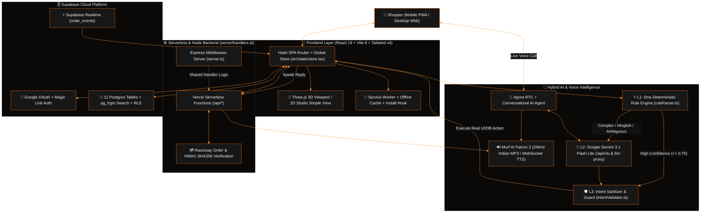
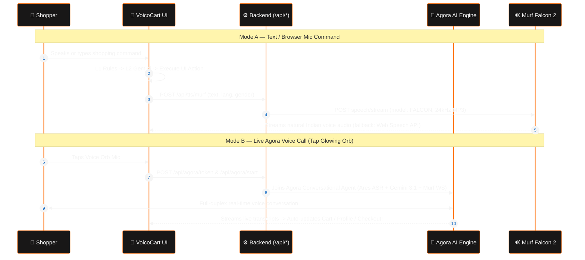
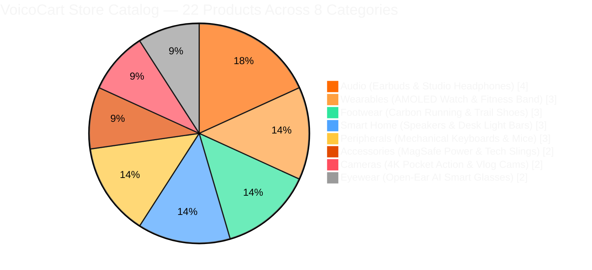
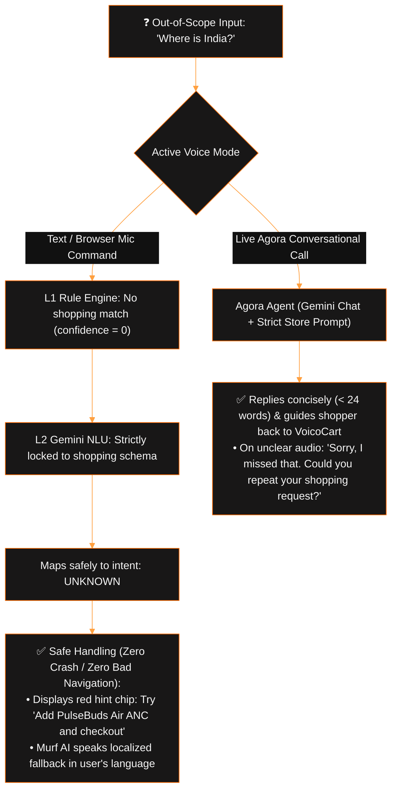

<div align="center">

<!-- Animated 3D Isometric Hero Banner (Color-Matched: #050505 Obsidian + #FF6A00 Sunset Copper) -->
<a href="https://buildathon-y5uv.vercel.app/">
  
</a>

<br /><br />

<!-- Dynamic Typing Sub-headline -->
<a href="https://buildathon-y5uv.vercel.app/">
  
</a>

<br />

<!-- Dynamic Color-Matched Badges (#050505 + #FF6A00 / #FFA040 / #2EE59D) -->
<p>
  <a href="https://buildathon-y5uv.vercel.app/">
    
  </a>
  
  
  
  
  
  
</p>

<!-- Quick Section Navigation -->
<p>
  <a href="#-architecture-overview">Architecture</a> •
  <a href="#-how-the-ai-thinks-3-layer-brain">AI Brain (LLM + Rules)</a> •
  <a href="#-murf-ai--agora-live-voice-pipeline">Murf &amp; Agora Voice</a> •
  <a href="#-catalog-separation--smart-search">Catalog Separation</a> •
  <a href="#%EF%B8%8F-exception--out-of-scope-handling">Exception Handling</a> •
  <a href="#-database--security-supabase">Supabase DB</a> •
  <a href="#-deployment--setup">Setup</a> •
  <a href="#-author--connect">Author</a>
</p>

</div>

---

## ✨ What Is VoicoCart?

**VoicoCart — Shop by Talking** is a production-grade, **voice-driven dark-mode commerce platform** built with an obsidian (`#050505`) and Sunset Copper (`#FF6A00`) spatial design language. Unlike standard chatbots that only reply with text, **VoicoCart turns natural speech into real UI & database actions**:

- 🎙️ **Hands-Free End-to-End Shopping**: Search products by budget/occasion, compare items side-by-side, add variants to cart, **fill & permanently save delivery addresses**, update profile info, switch 3D/2D modes, launch Razorpay checkout, and track or return orders — all by voice or text.
- 🧊 **Interactive Three.js 3D + Instant 2D Simple View**: Rotate 3D product models in real time with dynamic colorway lighting (`Obsidian Copper`, `Sunset Amber`, `Titanium Slate`), or toggle **Simple View (2D Studio Photos)** for instant lightweight browsing.
- 🗣️ **Real-Time Multilingual Voice (5 Indian Languages)**: Powered by **Agora Conversational AI** and **Murf AI Falcon 2** Indian voices across **English (IN), Hindi/Hinglish, Kannada, Tamil, and Telugu**.
- 📱 **Native-Like Mobile App & Installable PWA**: Sticky mobile header & bottom tab navigation, swipeable filter rails, offline status detection, Service Worker caching, and one-tap home-screen installation on Android & iOS.
- 🔐 **Enterprise-Ready Cloud Sync & Payments**: **Supabase PostgreSQL** with Row Level Security (RLS), Google OAuth & Magic Link sign-in, Realtime order tracking, and server-verified **Razorpay HMAC-SHA256** checkout.

---

## 🏗️ Architecture Overview

> End-to-end data flow connecting the React/Three.js client, Hybrid AI Engine, Express/Vercel Serverless Backend, Murf/Agora Voice Stack, and Supabase PostgreSQL.



---

## 🛠️ Complete Tech Stack

| Layer | Technologies Used | Purpose in VoicoCart |
| :--- | :--- | :--- |
| **Frontend UI** | `React 19`, `TypeScript`, `Vite 8`, `Tailwind CSS v4`, `Lucide Icons`, `Motion` | Dark matte obsidian UI (`#050505`), glassmorphic surfaces, mobile app bottom navigation |
| **3D & Media** | `Three.js`, `@types/three`, Custom 2D Studio Photography | Interactive 3D product previews with colorway switching + 2D Simple View fallback |
| **PWA & Offline** | `vite-plugin-pwa`, Workbox Service Worker, Custom SVG/PNG Manifest Icons | Installable Android/iOS home-screen app, asset caching, offline banner & fallback |
| **AI & NLU** | `@google/genai` (`gemini-3.1-flash-lite`), Custom Regex/Synonym Rule Engine | Hybrid 0ms local rules + strict JSON Schema LLM intent extraction |
| **Voice AI** | `agora-rtc-sdk-ng`, `agora-token`, **Agora Conversational AI**, **Murf AI Falcon 2**, Web Speech API | Real-time voice call agent, multi-language Indian neural TTS + browser speech fallback |
| **Backend** | `Node.js`, `Express 4`, **Vercel Serverless Functions** (`/api/*`), **Supabase Edge Functions** | Protects secret keys, signs Agora tokens, calls Gemini & Murf, verifies Razorpay orders |
| **Database & Auth** | **Supabase PostgreSQL**, `pg_trgm`, **Row Level Security (RLS)**, **Supabase Realtime** | User accounts, Google/Email Auth, fuzzy product search, saved addresses, live order tracking |
| **Payments** | **Razorpay Checkout JS SDK** + Server `HMAC-SHA256` Verification | Server-computed INR order totals + cryptographic payment signature validation |
| **Testing** | `node:test`, `node:assert/strict`, `tsx`, Playwright CLI | 13 deterministic NLU/catalog/security unit tests + live desktop & mobile UI checks |

---

## 🧠 How the AI Thinks (3-Layer Brain)

> Instead of letting an LLM hallucinate text replies that do nothing on screen, **VoicoCart** runs every command through a **3-Layer Hybrid Decision Pipeline**:

<div align="center">
  
</div>

### Step-by-Step Execution Flow:
1. **Layer 1 — Zero-Latency Local Rule Engine (`src/nlu/ruleParser.ts`)**:
   - Evaluates crisp shopping commands locally in **0ms** (works even completely offline): e.g., *"Add the second one"*, *"Compare 1 and 2"*, *"Save my delivery address: name Priya Nair, phone 9876543211, address 18 Indiranagar 100ft Rd, city Bengaluru, state Karnataka, pincode 560038"*, *"Turn on simple view"*, or *"Hindi mein bolo"*.
   - Also parses **compound chained commands** like *"Add PulseBuds Air ANC and redirect to checkout"* -> `[ADD_TO_CART, CHECKOUT]`.
2. **Layer 2 — Google Gemini LLM (`gemini-3.1-flash-lite`)**:
   - When a query is natural, Hinglish, regional, or ambiguous (e.g., *"Mom ke liye 3000 ke andar kuch acha gift dikhao"* or *"Running gear for morning jog"*), it invokes `supabase/functions/llm-proxy` or `/api/nlu`.
   - Uses `ThinkingLevel.MINIMAL` for ultra-low latency and enforces a **strict `responseSchema` (Structured JSON)** so Gemini can **only** emit validated intents & entities — it cannot invent fake products or tamper with prices.
3. **Layer 3 — Intent Sanitizer & Action Executor (`src/nlu/intentValidator.ts` & `store.tsx`)**:
   - Clamps quantities (`1–10`), validates category slugs, cleans Indian mobile numbers (`+91` -> 10 digits) and PIN codes, and dispatches live state + Supabase database updates.

<details>
<summary><b>📋 Click to View All 23 AI-Controlled Intents & Real Actions</b></summary>

| Category | Supported Intents | What the App Actually Does |
| :--- | :--- | :--- |
| **Discovery & Q&A** | `SEARCH_PRODUCTS`, `RECOMMEND`, `ASK_PRODUCT`, `COMPARE` | Filters 22 products, reads specs aloud, opens side-by-side comparison table |
| **Cart Control** | `ADD_TO_CART`, `REMOVE_FROM_CART`, `UPDATE_QUANTITY`, `CLEAR_CART`, `SHOW_CART` | Adds exact color/quantity, adjusts cart, updates badge & Supabase cart |
| **Profile & Address AI** | `SAVE_ADDRESS`, `UPDATE_PROFILE`, `FILL_CHECKOUT` | Extracts name, phone, street, city, state, pincode; saves permanently to Profile & Supabase `addresses` |
| **Checkout & Orders** | `CHECKOUT`, `CONFIRM`, `DENY`, `TRACK_ORDER`, `RETURN_ITEM` | Launches Razorpay payment flow, opens live order tracker, creates return ticket |
| **App & View UI** | `TOGGLE_SIMPLE_VIEW`, `NAVIGATE`, `SIGN_IN_GOOGLE`, `CHANGE_LANGUAGE`, `HELP`, `UNKNOWN` | Switches 2D/3D view, navigates screens, triggers Google OAuth, switches app language |

</details>

---

## 🎙️ Murf AI & Agora Live Voice Pipeline

VoicoCart supports **two synchronized voice architectures** (`src/voice/`):



### Supported Murf Falcon 2 Indian Voices (`src/voice/murfVoices.ts`)

| Language | Locale | Female Voice | Male Voice | Live ASR Language |
| :--- | :--- | :--- | :--- | :--- |
| **English (India)** | `en-IN` | **Anisha** | **Abhinav** | `en-IN` |
| **हिन्दी (Hindi & Hinglish)** | `hi-IN` | **Pooja** | **Prathamesh** | `hi-IN` |
| **ಕನ್ನಡ (Kannada)** | `kn-IN` | **Pooja** | **Harman** | `kn-IN` |
| **தமிழ் (Tamil)** | `ta-IN` | **Pooja** | **Karthikeyan** | `ta-IN` |
| **తెలుగు (Telugu)** | `te-IN` | **Pooja** | **Samar** | `te-IN` |

---

## 📦 Catalog Separation & Smart Search

VoicoCart maintains **22 distinct electronics, wearables & lifestyle products** neatly separated across **8 categories** (`src/data/catalog.ts` & Supabase `categories` + `products`):



### How Smart Catalog Filtering & Ranking Works:
1. **Multilingual Synonym Expansion**: Queries like *"morning jog"*, *"tws"*, *"magsafe"*, or Hindi/Kannada product words expand via `SYNONYMS` (e.g. `jog -> shoes/footwear`, `pods -> earbuds`).
2. **Hard Attribute Filters**: Filters strictly by `category`, `minPrice`, `maxPrice`, and colorway `variant`.
3. **Weighted Relevance Ranking**: Matches in **Product Title (`+4`)**, **Tags (`+3`)**, and **Description/Brand (`+1`)**, tie-broken by customer rating.
4. **PostgreSQL Fuzzy Search (`search_products` RPC)**: In Supabase, searches leverage a GIN `tsvector` index plus `pg_trgm` trigram similarity so even minor typos still find the exact product.

---

## 🛡️ Exception & Out-of-Scope Handling

What happens if someone asks the voice assistant an unrelated or out-of-limit question like ***"Where is India?"*** or ***"What is 2 + 2?"***



### Built-In Resilience Matrix

| Edge Case / Failure Scenario | Graceful Recovery Mechanism |
| :--- | :--- |
| **Out-of-Scope Query (*"Where is India?"*)** | Routed to `UNKNOWN`; keeps screen stable, shows helpful hint chip, speaks localized prompt |
| **Internet Disconnected (Offline)** | PWA `OfflineIndicator` alerts user; cached assets load; `L1 Rule Engine` works offline |
| **Gemini API Unavailable / No Key** | `nluRouter.ts` silently falls back to deterministic `ruleParser.ts` without breaking UI |
| **Murf TTS Error / Offline** | `speech.ts` seamlessly switches to browser `window.speechSynthesis` |
| **Invalid Quantities / Prompt Injection** | `intentValidator.ts` clamps quantities (`1–10`) and strips unapproved categories/intents |
| **Tampered Client Price at Checkout** | Backend recalculates INR totals from server `CATALOG` & verifies Razorpay `HMAC-SHA256` signature |
| **Low-End Mobile / Slow WebGL** | One-tap (or voice-triggered) **Simple View** swaps Three.js canvases for crisp 2D studio photos |

---

## 🗄️ Database & Security (Supabase)

<details>
<summary><b>🔍 Click to Expand Full Supabase PostgreSQL Schema (11 Tables + RLS + Realtime)</b></summary>

1. **`categories`** & **`products`** — Storefront catalog with `tsvector` + `pg_trgm` GIN indexes (`public read`).
2. **`profiles`** — User identity (`full_name`, `phone`, `email`, `avatar_url`, `preferred_lang`) auto-populated on Google/Email sign-in via `handle_new_user()` trigger.
3. **`addresses`** — Multi-address delivery book with `is_default` flag and instant Checkout prefill.
4. **`carts`** & **`cart_items`** — Persistent active cart synchronized across devices.
5. **`orders`**, **`order_items`**, & **`order_events`** — Complete order history + live status progression streamed via **Supabase Realtime**.
6. **`returns`** — One-click or voice-triggered return/refund tracking.
7. **`user_activity_logs`** — Audit trail logging `user_created`, `profile_updated`, and `address_saved`.

> Every user table enforces **Row Level Security (`auth.uid() = user_id`)** so users can strictly access only their own data. Guest users automatically persist data in `localStorage` and sync once signed in.

</details>

---

## 🚀 Deployment & Setup

<details>
<summary><b>⚙️ Click to View Local Setup, Environment Variables & Production Deployment Guide</b></summary>

### 1. Run Locally
```bash
git clone https://github.com/PIYUSH-JOSHI1/<your-repo-name>.git
cd <your-repo-name>
npm install
npm run dev
```

### 2. Run Automated Tests & Checks
```bash
npx --yes tsx --test src/nlu/nlu.test.ts   # 13 NLU, Compare, Voice & Address unit tests
npm run lint                                # TypeScript strict check
npm run build                               # Production Vite + PWA bundle
```

### 3. Environment Variables (`.env.example`)
| Variable | Scope | Purpose |
| :--- | :--- | :--- |
| `VITE_SUPABASE_URL` / `VITE_SUPABASE_ANON_KEY` | Public | Supabase Auth, Postgres DB & Realtime |
| `GEMINI_API_KEY` | Server Only | Gemini `gemini-3.1-flash-lite` NLU & Agora Agent LLM |
| `AGORA_APP_ID` / `VITE_AGORA_APP_ID` / `AGORA_APP_CERTIFICATE` | Client + Server | Live Agora RTC & Conversational AI Agent |
| `MURF_API_KEY` | Server Only | Murf AI Falcon 2 Indian TTS streaming |
| `RAZORPAY_KEY_ID` / `VITE_RAZORPAY_KEY_ID` / `RAZORPAY_KEY_SECRET` | Client + Server | Razorpay order creation & HMAC signature verification |

### 4. Supabase Database Setup
Run `supabase/migrations/001_init.sql` followed by `supabase/migrations/002_profile_logs_and_new_products.sql` in the **Supabase SQL Editor**, enable Google OAuth & Redirect URLs, and deploy to **Vercel**.

</details>

---

## 👨‍💻 Author & Connect

<div align="center">

<table width="100%">
  <tr>
    <td align="center" width="100%" bgcolor="#0B0908">
      <br />
      
      <h3>Piyush Joshi — Full-Stack & AI Engineer</h3>
      <p><i>Building voice-first spatial commerce, real-time AI interfaces & production web experiences.</i></p>
      <p>
        <a href="mailto:piyushaundhekar@gmail.com">
          
        </a>
        <a href="https://www.linkedin.com/in/piyush-joshi-81403925a/" target="_blank">
          
        </a>
        <a href="https://github.com/PIYUSH-JOSHI1" target="_blank">
          
        </a>
        <a href="https://piyush-joshi.netlify.app/" target="_blank">
          
        </a>
      </p>
      <br />
    </td>
  </tr>
</table>

<br />

<!-- Dynamic GitHub Activity Card (Color-Matched to Obsidian #050505 + Sunset Copper #FF6A00) -->
<a href="https://github.com/PIYUSH-JOSHI1">
  
</a>
<a href="https://github.com/PIYUSH-JOSHI1">
  
</a>

<br /><br />


</div>
