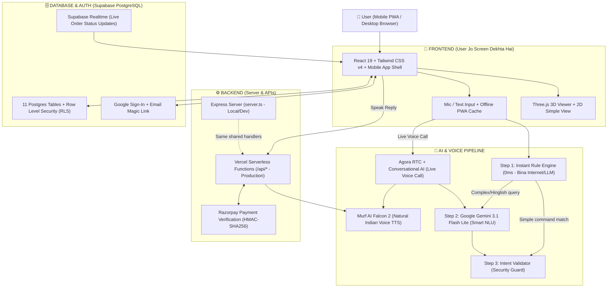
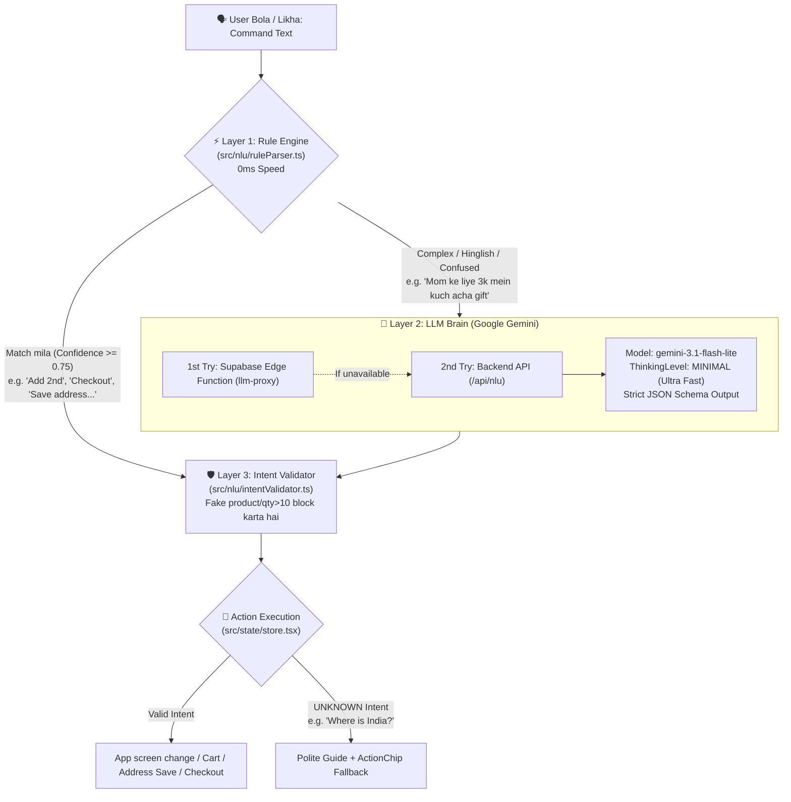
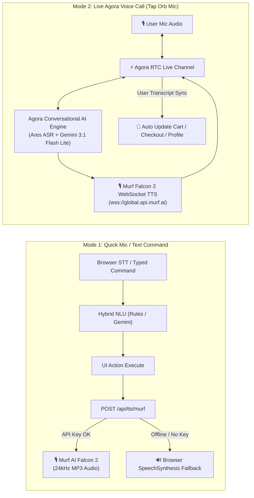
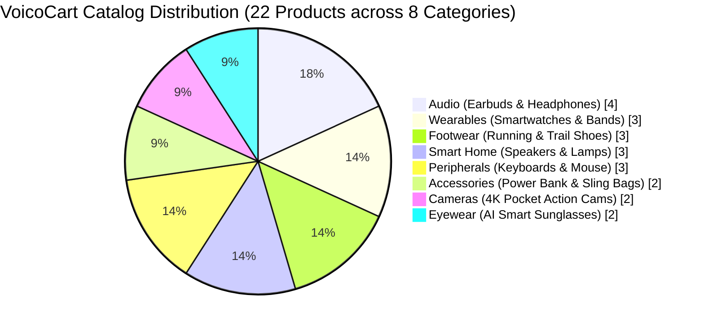
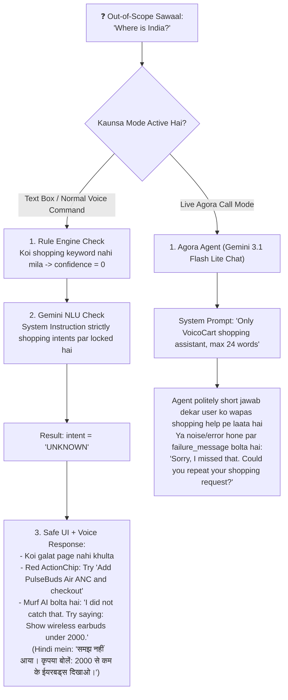

# VoicoCart — Shop by Talking (Complete Project Guide in Hinglish) 🎙️🛒

> **Non-Coders ke liye Simple Guide**: Agar aapko coding bilkul nahi aati, tab bhi is ek file ko padh kar aap 100% samajh jaoge ki **VoicoCart** andar se kaise chalta hai — Frontend, Backend, Database, AI Brain (Gemini + Rules), Murf Voice, Agora Live Call, Catalog Separation, aur agar koi out-of-limit sawaal pooche (jaise *"Where is India?"*) toh system kaise handle karta hai!

---

## 1. Project Kya Hai? (Ek Line Mein)

**VoicoCart** ek **Voice-First Indian E-Commerce Web App & Mobile PWA** hai jahan user bolkar ya type karke:
- Products dhoond sakta hai (`"2000 ke andar wireless earbuds dikhao"`)
- **3D** mein product ghuma ke dekh sakta hai (ya **Simple View 2D Photos** switch kar sakta hai)
- Products compare kar sakta hai (`"Compare 1 and 2"`)
- Cart aur Checkout form AI se fill aur save karwa sakta hai
- **Razorpay** se real payment karke live order track kar sakta hai
- Aur phone mein **Mobile App (PWA)** ki tarah install kar sakta hai!

---

## 2. Complete System Architecture Diagram (Sab Kuch Ek Picture Mein)

---

## 3. Tech Stack Breakdown (Kaunsi Technology Kya Kaam Karti Hai?)

### A. Frontend (Jo User Screen Par Dekhta & Touch Karta Hai)

| Technology | Simple Bhasha Mein Kaam | File / Jagah |
| :--- | :--- | :--- |
| **React 19 + TypeScript** | Poora app chalane wala UI engine + type-safety taaki bugs na aayein | `src/App.tsx`, `src/screens/*` |
| **Vite 8** | App ko super-fast build aur run karne wala bundler tool | `vite.config.ts` |
| **Tailwind CSS v4** | Dark-mode matte black luxury design, mobile bottom nav aur responsive styling | `src/index.css` |
| **Three.js** | Products ko live 3D mein ghuma kar dekhne ka engine | `src/components/three/*` |
| **Simple View (2D)** | Agar user fast browsing chahe toh 3D ki jagah studio 2D photos dikhata hai | `ProductViewer3D.tsx` |
| **PWA (`vite-plugin-pwa`)** | Website ko Android/iPhone par installable Mobile App banata hai (offline banner + icons) | `src/hooks/usePWAInstall.ts` |
| **Lucide React + Motion** | Clean icons aur smooth UI animations | `src/components/*` |

---

### B. Backend (Hidden Server Jo Secret Keys & Payments Handle Karta Hai)

> **Important**: Frontend par kabhi bhi secret keys (Gemini key, Murf key, Razorpay Secret, Agora Certificate) nahi rakhi jaati! Sab sensitive kaam backend API par hota hai.

| Technology / File | Kaam Kya Hai? |
| :--- | :--- |
| **`server.ts` (Express + Node.js)** | Local computer aur preview server par frontend + APIs ek saath port `3000` par chalata hai |
| **`api/*.ts` (Vercel Serverless)** | Live production (`vercel.app`) par bina heavy server ke har API endpoint ko cloud function ki tarah chalata hai |
| **`server/handlers.ts`** | **Main Brain File**: Express aur Vercel dono isi ek shared file ka logic use karte hain! |
| **`supabase/functions/*`** | Supabase ke edge functions (`llm-proxy`, `create-razorpay-order`, `verify-payment`, `advance-order-status`) |

#### Backend API Endpoints List
1. `GET /api/health` — Check karta hai kaunsi services (Gemini, Supabase, Razorpay, Agora, Murf) active hain.
2. `POST /api/nlu` — User ke sentence ko Gemini AI se structured shopping command (JSON) banwata hai.
3. `POST /api/tts/murf` — Text reply ko Murf AI Falcon 2 se MP3 audio (Indian voice) me convert karta hai.
4. `POST /api/agora/token` — Live voice call ke liye secure Agora RTC token banata hai.
5. `POST /api/agora/start` & `/stop` — Agora Conversational AI Agent ko call me join / leave karwata hai.
6. `POST /api/razorpay/create-order` — Backend par catalog se asli price calculate karke Razorpay order banata hai.
7. `POST /api/razorpay/verify` — Payment ke baad cryptographic HMAC signature verify karta hai (taaki fraud na ho).

---

### C. Database & Login System (Supabase PostgreSQL)

Supabase hamara **Cloud Database + Login System + Live Tracker** hai (`supabase/migrations/001_init.sql` & `002_profile_logs_and_new_products.sql`):

| Table Name | Ismein Kya Store Hota Hai? |
| :--- | :--- |
| **`categories`** | 8 shopping categories (`audio`, `wearables`, `smart-home`, `footwear`, `peripherals`, `cameras`, `eyewear`, `accessories`) |
| **`products`** | Saare 22 products, unki price, MRP, rating, stock, specs (JSON), colors, tags, aur Full-Text Search index |
| **`profiles`** | User ka naam, mobile number, email, Google photo (`avatar_url`), aur preferred language (`en-IN`, `hi-IN`, etc.) |
| **`addresses`** | User ke saved delivery addresses (`Default` badge, city, state, pincode, phone) |
| **`carts` & `cart_items`** | Login user ka cloud shopping cart |
| **`orders`, `order_items`, `order_events`** | Placed orders, items aur order tracking timeline (`paid -> packed -> shipped -> out_for_delivery -> delivered`) |
| **`returns`** | Order return requests aur refund status |
| **`user_activity_logs`** | Security & activity logs (`user_created`, `profile_updated`, `address_saved`, etc.) |

#### Database Security & Magic Features:
- **Row Level Security (RLS)**: Har user table par lock laga hai (`auth.uid() = user_id`), matlab ek user kabhi kisi doosre user ka address, order ya profile nahi dekh sakta.
- **Auto Profile Trigger (`handle_new_user`)**: Jaise hi koi Google ya Magic Link se pehli baar sign-in karta hai, Supabase automatically `profiles` table mein entry bana deta hai aur `user_activity_logs` mein log save karta hai.
- **Postgres Fuzzy Search (`search_products`)**: Database ke andar `pg_trgm` aur `tsvector` laga hai taaki spelling thodi galat bhi ho toh sahi product mil jaye.
- **Offline / Guest Fallback**: Agar user signed-in nahi hai, tab bhi cart, orders aur saved addresses browser ki `localStorage` mein save rehte hain (aur sign-in karte hi cloud se sync ho jaate hain).

---

## 4. Hamara AI Kaise Sochta Aur Kaam Karta Hai? (LLM + Rules + Validation)

Bahut log sochte hain ki AI har baar seedha ChatGPT/Gemini ki tarah paragraph likhta hai — **VoicoCart aise kaam nahi karta!** Kyunki e-commerce app mein AI ko sirf baatein nahi karni, balki **buttons dabane, cart update karne, address save karne aur checkout kholne** jaise real actions karne hote hain.

Iske liye humne **3-Layer Hybrid AI Brain** banaya hai (`src/nlu/`):

### Ismein Kaunsa LLM Use Hota Hai?
- **Model**: **Google Gemini `gemini-3.1-flash-lite`** (`ThinkingLevel.MINIMAL` mode par, taaki millisecond speed mein reply aaye).
- **Kahaan Call Hota Hai?**:
  1. Text/Command NLU mein (`server/handlers.ts` -> `handleNlu`) — ye user ke natural Hinglish, Hindi, Kannada, Tamil, Telugu ya English sentence ko ek fixed **JSON Structure** mein convert karta hai (jaise `{ intent: "SEARCH_PRODUCTS", entities: { category: "footwear", maxPrice: 3000 } }`).
  2. Live Agora Call mein (`server/handlers.ts` -> `handleAgoraStart`) — wahan bhi Gemini `gemini-3.1-flash-lite` conversational agent ke dimaag ki tarah juda hai.

### AI Khud Action Kaise Leta Hai? (23 Allowed Intents)
AI sirf inhi approved kaamon mein se action chunta hai:
- **Shopping**: `SEARCH_PRODUCTS`, `RECOMMEND`, `ASK_PRODUCT`, `COMPARE`
- **Cart & Order**: `ADD_TO_CART`, `REMOVE_FROM_CART`, `UPDATE_QUANTITY`, `CLEAR_CART`, `SHOW_CART`, `CHECKOUT`, `CONFIRM`, `DENY`, `TRACK_ORDER`, `RETURN_ITEM`
- **Full Form & App Control**: `FILL_CHECKOUT`, `SAVE_ADDRESS`, `UPDATE_PROFILE`, `TOGGLE_SIMPLE_VIEW`, `NAVIGATE`, `SIGN_IN_GOOGLE`, `CHANGE_LANGUAGE`, `HELP`
- **Out-of-Scope Safety**: `UNKNOWN`

> **Chained Actions (Ek Saath 2 Kaam)**: Agar user bole *"Add PulseBuds Air ANC to my cart and redirect to checkout"*, toh AI ek saath `[ADD_TO_CART, CHECKOUT]` queue bana deta hai — item cart mein add hota hai aur turant Checkout page khul jaata hai!

---

## 5. Murf AI & Agora Voice Kaise Kaam Karte Hain?

VoicoCart mein **Voice ke 2 smart modes** hain taaki app hamesha bole aur sune (`src/voice/`):

### Murf AI Voices (5 Indian Languages + Male/Female Options)
Profile page par user language aur voice gender choose kar sakta hai (`src/voice/murfVoices.ts`), aur dono (**Murf Falcon 2** + **Agora ASR**) usi ke hisaab se switch ho jaate hain:

| Language | Code | Female Voice (Murf Falcon 2) | Male Voice (Murf Falcon 2) |
| :--- | :--- | :--- | :--- |
| **English (India)** | `en-IN` | **Anisha** | **Abhinav** |
| **हिन्दी (Hindi & Hinglish)** | `hi-IN` | **Pooja** | **Prathamesh** |
| **ಕನ್ನಡ (Kannada)** | `kn-IN` | **Pooja** | **Harman** |
| **தமிழ் (Tamil)** | `ta-IN` | **Pooja** | **Karthikeyan** |
| **తెలుగు (Telugu)** | `te-IN` | **Pooja** | **Samar** |

---

## 6. Catalog Separation & Smart Search Kaise Kaam Karti Hai?

Humare store mein **22 distinct products** ko **8 clear categories** mein divide kiya gaya hai (`src/data/catalog.ts`):

### Search & Separation Ka Formula (`searchCatalog` Function):
Jab user kuch search karta hai (jaise `"morning jog ke liye kuch 3000 ke andar"`), toh ye 4 steps chalte hain:
1. **Synonym Expansion**: Code mein ek synonym dictionary hai — `"jog"` ya `"running"` ko woh automatically `shoes` / `footwear` se link kar deta hai; `"tws"` / `"pods"` ko `earbuds` se; `"magsafe"` ko `powerbank` se.
2. **Hard Filter**: Sabse pehle `category`, `minPrice`, `maxPrice`, aur `color` ke hisaab se galat items hata diye jaate hain.
3. **Relevance Scoring**:
   - Agar product ke **Title** mein word mila = **+4 points**
   - Agar product ke **Tags** mein word mila = **+3 points**
   - Agar **Description / Brand / Category** mein mila = **+1 point**
   - Equal score par highest **Rating** wala product upar aata hai!
4. **Zero-Match Safety**: Agar kisi ajeeb filter se `0` products bachein, toh screen khaali nahi dikhti — app politely message dekar **Top Rated Gear** dikha deta hai.

---

## 7. Exception Handling: Agar Koi Limit Se Bahar Ka Sawaal Pooche (Jaise *"Where is India?"*) Toh Kya Hota Hai?

Ye sabse important test hai! Maan lo user ne Voice Assistant ya Search Bar mein pooch liya:
> **"Where is India?"** (ya *"Aaj mausam kaisa hai?"* ya *"2+2 kya hota hai?"*)

App is situation ko **bina crash hue** mode ke hisaab se aise handle karta hai:

### Doosri Exceptions & Errors Kaise Handle Kiye Jaate Hain?
| Problem / Exception | App Kya Backup Plan Chalata Hai? |
| :--- | :--- |
| **Internet chala gaya (Offline)** | Top par **Offline Banner** dikhta hai; PWA cache se app load rehta hai; Local `ruleParser` bina internet bhi commands samajhta hai! |
| **Gemini API Key missing ya down hai** | `nluRouter.ts` automatically **Local Rule Engine** par fallback ho jaata hai taaki search, cart, address aur navigation chalta rahe. |
| **Murf TTS fail ho gaya ya limit khatam** | `speech.ts` turant browser ke built-in **Web Speech Synthesis** se reply bol deta hai — voice band nahi hoti! |
| **User ne AI ko fake quantity (e.g. 500) ya galat category boli** | `intentValidator.ts` quantity ko max **10** par lock kar deta hai aur fake categories ko reject kar deta hai. |
| **Payment amount tamper karne ki koshish** | Backend (`handleCreateRazorpayOrder`) browser ke bheje total par bharosa nahi karta — khud catalog se asli price calculate karta hai aur HMAC signature check karta hai! |
| **WebGL / 3D kisi saste phone par slow chale** | User **"Simple View (2D Studio Photos)"** ON kar sakta hai (ya voice se bol sakta hai *"Turn on simple view"*). |

---

## 8. User Journeys at a Glance (Har Screen Ka Kaam)

1. **Home (`#/`)**: Voice/Text command bar, swipeable category pills (`All Gear`, `Audio`, `Cameras`, etc.), featured products.
2. **Explore (`#/results`)**: 22 products ka 2-column mobile grid, price/category filters, 3D/2D view badges.
3. **Product Detail (`#/product/:id`)**: Interactive Three.js 3D preview + color switch + Simple 2D Studio Photo toggle + specs + sticky mobile Add to Cart bar.
4. **Compare (`#/compare`)**: 2-3 products ki side-by-side comparison table aur AI verdict (`Best Value`, `Top Rated`).
5. **Cart (`#/cart`) & Checkout (`#/checkout`)**: Saved Delivery Addresses quick-fill + "Save Address" + Razorpay secure checkout.
6. **Orders (`#/orders`)**: Live order status stepper (Supabase Realtime sync) + Return item button.
7. **Profile (`#/profile`)**: Google Sign-In, Email Magic Link, Personal Information, Language & Murf Voice selector, Simple View toggle, Install Mobile App (PWA), aur Saved Delivery Addresses manager.

---

## 9. Deployment & Production Map (Kahan Kya Chal Raha Hai?)

- **Frontend + Serverless API Hosting**: **Vercel** (`vercel.json` + `/api/*`)
- **Database, Auth, Realtime & Edge Functions**: **Supabase** (`PostgreSQL` + `Auth` + `Edge Functions`)
- **AI Brain (NLU)**: **Google Gemini API** (`gemini-3.1-flash-lite`)
- **Live Voice Engine**: **Agora Conversational AI + Agora RTC SDK**
- **Indian Multilingual TTS**: **Murf AI Falcon 2**
- **Payments**: **Razorpay Orders & Verification API**

> *Yeh documentation VoicoCart ke actual codebase (`src/`, `server/`, `api/`, `supabase/`) ko inspect karke banayi gayi hai taaki har flow, model name, voice ID aur fallback 100% accurate rahe.*
